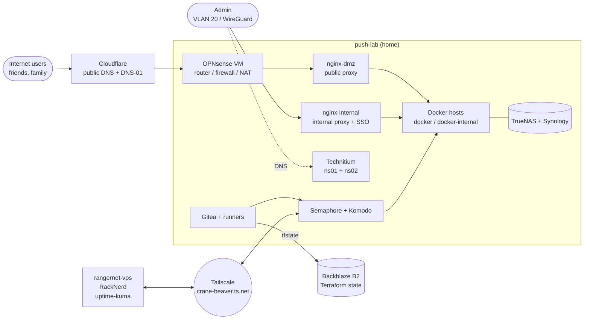

# 1. Overview

push-lab is a two-node VMware vSphere homelab behind an OPNsense firewall. It runs about 17 VMs, two Raspberry Pis and one public VPS.

Configuration is split across two Git repos, both hosted on the lab's own Gitea:

| Repo | Owns | Deployed by |
|---|---|---|
| `push-lab_2_0` (this repo) | VM templates, VM provisioning, OS config, host firewalls, reverse proxies, DNS records, OPNsense rules | Gitea Actions (Packer, Terraform) → **Semaphore** (Ansible) |
| `docker-stacks` | Docker Compose stacks per host | **Komodo** (webhook on merge); updates proposed by **Renovate** |

## System context

## Domains

| Domain | Use |
|---|---|
| `push-lab.com` | Main lab domain. Internal apps go through nginx-internal; a few public ones go through nginx-dmz |
| `ryanpampush.com` | Public media front door (plex, request, cloud), landing page |
| `rangernet.dev` | Landing page, `mqtt.` (MQTTS), `logs.` (VictoriaLogs) |
| `patreons7.club` | Nextcloud (`nc.`, `bigfile.`) |
| `localdomain` | Internal host names, authoritative on ns01/ns02 |
| `crane-beaver.ts.net` | Tailscale tailnet |

## Design principles visible in the setup

- **Everything as code where practical.**
  - VMs built by Terraform from a Packer template; OS and edge config through Ansible; containers through Compose + Komodo GitOps.
  - Older hand-built VMs are being brought under Ansible ("manual" inventory).
- **Segmentation by VLAN.** Servers sit in the DMZ (70) or App (80) VLANs. Admins work from Trusted (20). IoT (50) and Guest (60) are isolated. Management (10) has no WAN.
- **Two reverse proxies.** One for the public internet (nginx-dmz) and one for internal and SSO-gated apps (nginx-internal).
- **Single sign-on** through Keycloak (realm `prod`) with oauth2-proxy in front of apps that have no auth of their own.
- **Pinned, auto-proposed updates.** Every image is pinned `tag@sha256`. Renovate proposes bumps, low-risk ones automerge, and Komodo deploys on merge.
- **Redundant DNS/DHCP.** ns01 is primary and ns02 is a warm standby.

## Tool chain

| Concern | Tool | Where it runs |
|---|---|---|
| Hypervisor | vSphere 8 (ESXi 8.0.3, VCSA 8.0.2) | chonkyboi, slimboi |
| VM image | Packer (vsphere-iso, AlmaLinux 10) | packer_builder runner |
| Provisioning | Terraform 1.7.5, state on B2 | Gitea Actions |
| Config mgmt | Ansible (EE image `ansible-ee`) | Semaphore on docker-internal |
| CI | Gitea Actions (`alma`, `packer-vm` runners) | gitea, packer_builder |
| Container deploy | Komodo v2 Core + Periphery | docker-internal + every container host |
| Dependency updates | Renovate | docker-internal (Komodo procedure) |
| DNS/DHCP | Technitium | docker-secure (ns01), ns02 |
| Identity | Keycloak + oauth2-proxy | docker, docker-internal |
| Observability | Alloy, VictoriaMetrics, VictoriaLogs, Grafana, InfluxDB, Uptime Kuma | docker-internal, VPS |
| Security | CrowdSec LAPI + agents, firewalld (`firewall_hardened`) | crowdsec, proxies, VPS |
| Backup | Veeam B&R | Veeam2022 VM |
