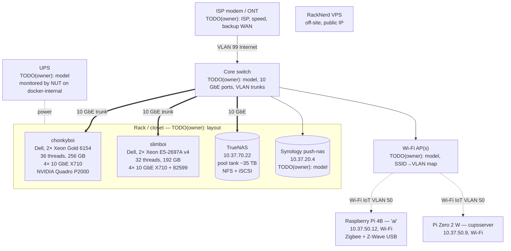

# 2. Physical architecture

Sources: vCenter (vc), SSH survey (live), NAS `showmount` output. Anything that couldn't be discovered is marked `TODO(owner):`.

## Physical layout

> The WAN reaches the **OPNsense VM** through vDS port group `VLAN 99 - Internet`. The ISP handoff is VLAN-tagged on the switch and trunked to the ESXi hosts. If either ESXi host or the vDS goes down, so does routing. TODO(owner): confirm which host(s) OPNsense can run on and the switch port mapping.

## Compute: ESXi cluster `Lab Cluster` (datacenter `Push Datacenter`)

| | chonkyboi.localdomain | slimboi.localdomain |
|---|---|---|
| Vendor | Dell (TODO(owner): model/service tag) | Dell (TODO(owner): model) |
| CPU | 2× Intel Xeon Gold 6154 @ 3.0 GHz, 36 logical | 2× Intel Xeon E5-2697A v4 @ 2.6 GHz, 32 logical |
| RAM | 256 GB (~59% used) | 192 GB (~54% used) |
| ESXi | 8.0.3 build 24674464 | 8.0.3 build 24674464 |
| NICs | 4× 10 GbE Intel X710 (all up) | 4× 10 GbE Intel X710 (up) + Intel 82599 (link down) |
| vmkernel | 10.37.10.17 (mgmt), 10.37.70.31/.32, 10.37.30.42 (storage) | 10.37.10.18 (mgmt), 10.37.70.29/.30, 10.37.30.41 (storage) |
| PCIe passthrough | NVIDIA Quadro P2000 → VM `Docker` | — |
| Last boot | 2026-02-11 | 2025-06-16 |
| Hosted VMs | opnSense, Docker, NGINX, GameServer, Veeam2022, vCenter, dns02 | Docker-Internal, Docker-Secure, gitea, packer_builder, NGINX-Internal, Crowdsec, prusa3dbawkz, HomeAssistant, templates |

Networking is a single **vSphere Distributed Switch** `DSwitch` with one port group per VLAN (see [network](03-network.md)) plus `ISCSI-PG1` / `ISCSI-PG2` for storage multipathing.

vCenter: VCSA 8.0.2 at 10.37.10.35 (VLAN 10), 6 vCPU / 24 GB, running on chonkyboi.

## Storage hardware

| Device | Address | Role |
|---|---|---|
| **TrueNAS** (physical; SSH disabled) | 10.37.70.22 (VLAN 70), storage vmk on VLAN 30 | Pool `tank`. Serves NFS datastore `FreeNas 10GbE` (35 TB, 26 TB free) to ESXi and iSCSI datastores `FreeNas iscsi` / `iscsi2` (400 GB each). NFS exports to docker hosts (see [storage](08-storage-backup.md)) |
| **Synology push-nas** | 10.37.20.4 (VLAN 20) | NFS exports: `digx` (Immich library), `Backup`, `Docker`, `ESXi`. TODO(owner): model, disk layout |

### ESXi datastores

| Datastore | Type | Size | Free | Used by |
|---|---|---|---|---|
| ssd-local | VMFS | 1.86 TB | 1.41 TB | Terraform default; most slimboi VMs |
| ssd_local1 | VMFS | 1.79 TB | 986 GB | chonkyboi VMs (Docker, NGINX, GameServer, vCenter, Veeam) |
| NVMe1 Datastore | VMFS | 699 GB | 447 GB | Docker (`/downloads`) |
| datastore1 | VMFS | 95 GB | 94 GB | boot-local, unused |
| FreeNas iscsi | VMFS (iSCSI) | 400 GB | 272 GB | opnSense, Docker-Secure, Veeam, prusa |
| FreeNas iscsi2 | VMFS (iSCSI) | 400 GB | 228 GB | Docker-Secure, HomeAssistant |
| FreeNas 10GbE | NFS | 35 TB | 26 TB | bulk |

> OPNsense and ns01 (Docker-Secure) boot from **TrueNAS iSCSI**. If TrueNAS is down, routing and primary DNS are down too. ns02 is on chonkyboi's local `ssd_local1` (moved 2026-11-15), so it survives a NAS outage and doesn't share a host with ns01. See [findings](findings.md).

## Edge devices

| Device | Name / IP | Hardware | Function |
|---|---|---|---|
| Raspberry Pi 4B | raspberrypi-ha (hostname `ai`), 10.37.50.12 | 4 cores, 3.7 GB, SD card 29 GB, Wi-Fi only | Zigbee2MQTT (Sonoff Zigbee 3.0 USB Dongle Plus), Z-Wave JS (USB stick `0658:0200`) |
| Raspberry Pi Zero 2 W | cupsserver, 10.37.50.9 | 4 cores, 416 MB, SD 28 GB, Wi-Fi | CUPS print server (TODO(owner): printer model) |
| GPU | in chonkyboi → VM Docker | NVIDIA Quadro P2000 | Plex + Tdarr NVENC |
| UPS | via NUT (`nut-upsd` on docker-internal) | TODO(owner): model, runtime, which hosts are on it | PeaNUT dashboard, metrics to InfluxDB |

## Off-site

| Item | Details |
|---|---|
| rangernet-vps | RackNerd KVM, 6 vCPU (E5-2690 v4), 7.5 GB, 144 GB. Public IP 192.210.235.136, Tailscale 100.78.119.4 |
| Backblaze B2 | Terraform state bucket |
| Cloudflare | DNS for public zones; DNS-01 for certificates |

## Physical TODO checklist (for owner)

- [ ] Switch model, port map, uplink/LAG to each ESXi host and TrueNAS
- [ ] Wi-Fi AP model and SSID → VLAN mapping
- [ ] ISP, circuit speed, modem; backup WAN (OPNsense `opt4`) medium
- [ ] Rack elevation / closet layout
- [ ] UPS model, load, and runtime; shutdown orchestration (NUT clients?)
- [ ] TrueNAS hardware (chassis, disks, vdev layout); Synology model and RAID
- [ ] Dell server models and service tags; iDRAC IPs
