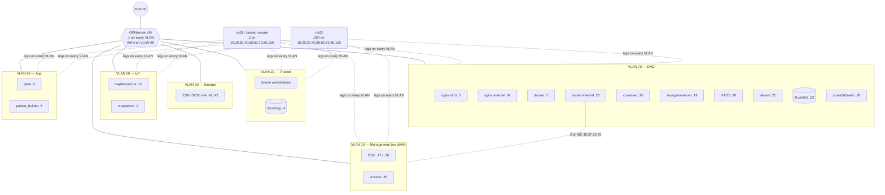
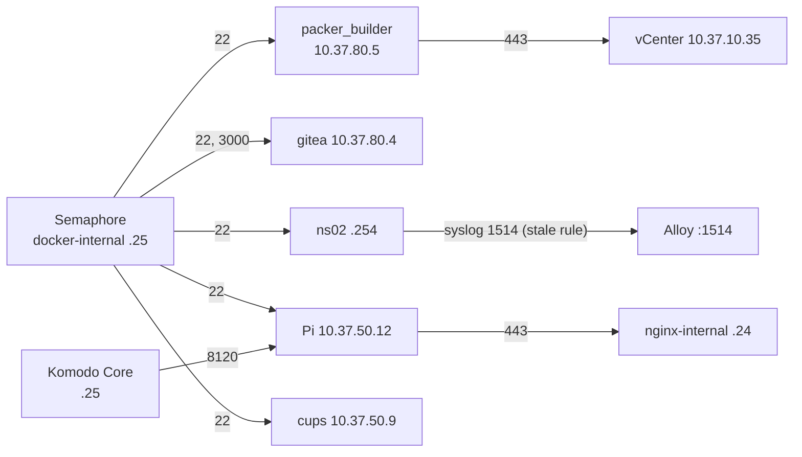
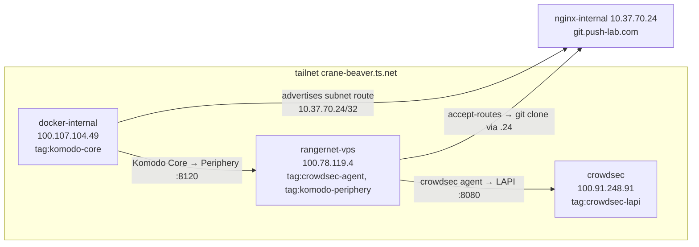

# 3. Network

Sources:
- `ansible/group_vars/opnsense/vars.yml`
- `terraform/envs/prod/prod.tfvars`
- `ansible/roles/firewall_hardened/defaults/main.yml`
- vCenter port groups
- live `ip -br a`

## Addressing scheme

- Every VLAN is **`10.37.<VLAN>.0/24`** with the gateway at **`.1`** (OPNsense). IPv6 ULA is `fd00:1337:1337:<VLAN>::/64`.
- Hosts on many VLANs keep the same last octet everywhere:
  - **ns01 = `.2`**
  - **ns02 = `.254`**
  - **OPNsense = `.1`**

| VLAN | Name | OPNsense iface | WAN? | What lives here |
|---|---|---|---|---|
| 10 | Management | opt1 | No | ESXi vmk (.17, .18), vCenter (.35), ns01 (.2, canonical mgmt IP), docker-internal second NIC (.42), ns02 (.254), Veeam second NIC |
| 20 | Trusted | opt2 | Yes | Admin workstations (e.g. .41), Synology (.4). Admin access to ns01 is via **10.37.20.2** |
| 30 | Storage | opt3 | — | ESXi storage vmk (.41, .42), iSCSI |
| 40 | LAN Only (No WAN) | — | No | Isolation (only ns01/ns02 legs) |
| 50 | IoT | opt5 | Restricted | Raspberry Pi HA (.12), CUPS (.9) |
| 60 | Guest | opt6 | Yes | Guests (only ns01/ns02 legs for DHCP/DNS) |
| 70 | DMZ | opt7 | Yes | Almost every server (see host map below) |
| 80 | App | opt9 | Yes | Terraform-built VMs: gitea (.4), packer_builder (.5). Default gateway for ns01/ns02. Has public IPv6 GUA |
| 90 | WireGuard | opt8 | — | Remote-access VPN clients |
| 99 | Internet | wan | — | WAN uplink into OPNsense (backup WAN = opt4) |
| 100 | Test | — | — | Test (only ns01/ns02 legs) |
| 120–170, 1100 | Stage | — | — | Port groups exist in the vDS; unused |

## Topology

### Multi-homed hosts

| Host | NICs | Default route | Notes |
|---|---|---|---|
| ns01 (docker-secure) | 9 (.2 on 10,20,30,40,50,60,70,80,100) | 10.37.80.1 (static) | It is its own resolver, so Periphery uses DNS 10.37.70.2 |
| ns02 | 9 (.254). Terraform list: VLAN 10 primary, then 20,30,40,50,60,80,100, then **70 last on purpose**. Guest ethN order differs: eth0..8 = 40,100,10,50,70,20,60,30,80 | 10.37.80.1 via eth8 | **Append NICs only.** Terraform pairs NICs by list index, and strict rp_filter breaks cross-VLAN reachability if they rotate. Ansible uses 10.37.70.254 because Semaphore is on the same segment, which keeps the path symmetric. From a VLAN 20 workstation only 10.37.20.254 answers |
| docker-internal | ens33 10.37.70.25, ens35 10.37.10.42 | **Two default routes** (metric 100 via 70, 200 via 10) | See findings |
| OPNsense | 10 vNICs (VLAN 99 WAN + 9 internal) | WAN | — |
| Veeam | VLAN 10 + 70 | — | — |

## Inter-VLAN flows (rules managed in IaC)

The OPNsense rules in `ansible/group_vars/opnsense/vars.yml` cover only the flows below. Everything else, **including all NAT / port forwards**, is hand-managed in the OPNsense UI. TODO(owner): export the rules or bring them under IaC.

Aliases defined in IaC: `veeammachine`, `veeam_ports`, `semaphore`, `cupsserver`, `dns02` (70.254 + 80.254), `internal_networks`, `web_https`.

Expected public port forwards, inferred from the listening services (TODO(owner): confirm):

| WAN port | → | Target |
|---|---|---|
| 80, 443 | → | nginx-dmz 10.37.70.5 |
| 8883 (MQTTS) | → | nginx-dmz 10.37.70.5 → mosquitto .25:1883 |
| 7777 tcp/udp | → | linuxgameserver 10.37.70.19 (Satisfactory) |
| WireGuard | → | OPNsense (VLAN 90) |

## Tailscale overlay

- Auth keys are minted from a Tailscale OAuth client (role `tailscale`).
- The VPS needs firewalld trusted-zone **masquerade** for the subnet route to work.

## Host firewalls (`firewall_hardened`)

- firewalld with rich rules. Access levels: `public`, `trusted_vlan` (VLAN 20 / 90 as admin sources), `custom`, plus proxy and SSH allowlists.
- Veeam agent ports are opened globally (`group_vars/all/main.yml`).
- Docker hosts put `docker0` in the trusted zone.
- rangernet-vps uses `firewall_hardened_strict_allowlist` (default deny, public SSH).
- **Caveat:** Docker publishes ports through its own iptables chains, so firewalld doesn't filter container ports. On docker, docker-internal and prusa3dbawkz the active zone has **no interfaces** bound, so the host does no filtering at all. OPNsense is the only filter there.
