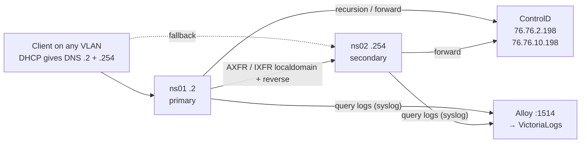
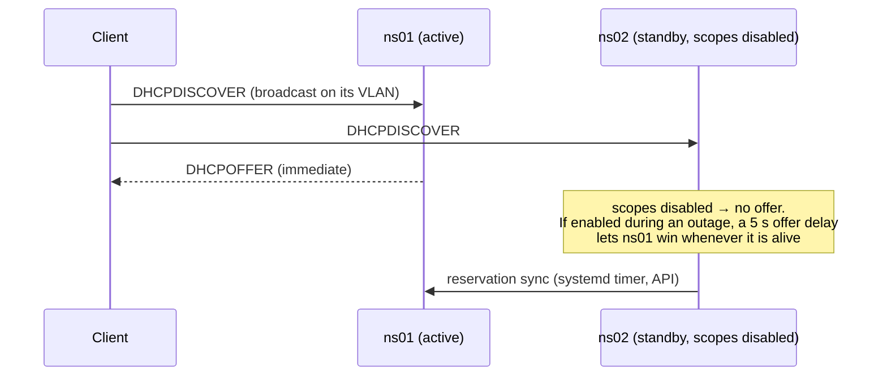

# 4. DNS & DHCP

Sources:
- `ansible/inventories/prod/host_vars/ns02.yml`
- `ansible/technitium.yml`
- `ansible/group_vars/all/hosts_registry.yml`
- `docs/ns-names.md`
- `docs/dns01-config-snapshot/`
- docker-stacks `docker-secure/technitium`, `ns02/technitium`

## Roles

| | ns01 | ns02 |
|---|---|---|
| Runs on | docker-secure VM (Ubuntu 24.04) | VM `dns02` (AlmaLinux 10.2, Terraform-managed) |
| Software | Technitium DNS Server (`technitium/dns-server:latest@sha256`), host network | same |
| Deployed by | Komodo stack `technitium-ns01` | Komodo stack `technitium-ns02` (Ansible role `technitium` handles host prep and config via API) |
| Addresses | `.2` on VLANs 10,20,30,40,50,60,70,80,100 | `.254` on the same VLANs |
| DNS role | **Primary** (SOA) for `localdomain` + reverse zones | **Secondary** (zone transfer from ns01) |
| DHCP | **Active** for 8 scopes | Mirror scopes **disabled**. Warm standby with a 5000 ms offer delay; a reservation-sync timer pulls reservations from ns01 |
| Web console | :5380 | :5380 on all IPs |
| Storage | named volume `technitium_config` | `/opt/technitium/config` (bind) |

## Resolution flow

## Zones

| Zone | Type | Records come from |
|---|---|---|
| `localdomain` | Primary on ns01, secondary on ns02 | `hosts_registry.yml` → `technitium.yml` (records-as-code) |
| `push-lab.com`, `ryanpampush.com`, `patreons7.club`, `rangernet.dev` | Forwarder zones with internal overrides (split horizon) | Hand-maintained in Technitium. `public_dns_records` in `hosts_registry.yml` documents them, but **no playbook applies it** |
| `10.37.X.in-addr.arpa` | Reverse, one per VLAN | Technitium |

Split horizon: internal clients resolve app hostnames straight to the LAN proxy IP and don't hairpin through the WAN.

| Target | Hostnames |
|---|---|
| nginx-internal 10.37.70.24 | code, dashboard, digx, dozzle, git, grafana, lidarr, prusabawt, radarr, readarr, sab, semaphore, sonarr, syno, truenas, zigbee, zwave (`.push-lab.com`), `mqtt.rangernet.dev` |
| nginx-dmz 10.37.70.5 | auth, cargame-dev, invite, n8n, plex (`.push-lab.com`), cloud / plex / request (`.ryanpampush.com`), `nc.patreons7.club` |
| Direct | `ha.push-lab.com` → 10.37.70.20, `satisfactory` → .19, `sso` → .7, `teslamate.ryanpampush.com` → .7, `logs.rangernet.dev` → .25 |

Public (internet-facing) records are in Cloudflare. TODO(owner): list which records are proxied (orange cloud) versus DNS-only.

## DHCP failover

Failover is manual: enable the ns02 scopes in Technitium. TODO(owner): confirm the runbook. `docs/dns02-secondary-and-dhcp-sync.md` has the design.

## Operations

- **Change a record:** edit `hosts_registry.yml` and run the Technitium template in Semaphore (project 1, template 13). API tokens are Semaphore env `TECHNITIUM_API_TOKEN_NS01` / `_NS02`.
- **Upgrade Technitium:** Renovate bumps the digest in docker-stacks, then Komodo redeploys. Snapshots are at `/var/backups/technitium-*` on ns02.
- **Naming history:** dns01/dns02 were renamed to ns01/ns02 on 2026-09-07. The Terraform key is still `dns02` and the vCenter VM name is `dns02` (`docs/ns-names.md`).
