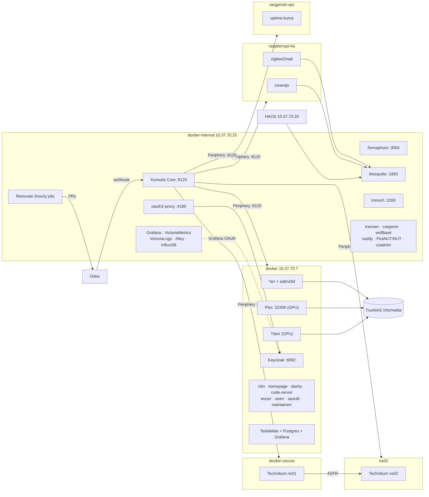

# 6. Services

All container stacks live in the `docker-stacks` repo under `<host>/<stack>/` and are deployed by Komodo.

- **Image pinning:** every image is pinned `name:tag@sha256:…` and Renovate bumps them.
- **Ports:** only host ports are listed.
- **Storage tiers** (docker-internal):
  - `san`: `/srv/docker/san/<stack>` on TrueNAS NFS
  - `local`: `/srv/docker/<stack>`
  - `git`: config committed in the repo

  On docker, data lives under `/opt/dockerconfigs/<stack>`.

## Service map

## docker (10.37.70.7)

| Stack | Service(s) & image | Host ports | Storage / notes | Exposed as |
|---|---|---|---|---|
| plex | `plexinc/pms-docker` 1.43.5 | host net (32400) | `/opt/plex-config`, `/nfs/media`, `/transcode`; nvidia runtime | plex.push-lab.com, plex.ryanpampush.com (DMZ) |
| arr | prowlarr 2.6.5, nzbhydra2 9.1.1, sabnzbd 5.1.3, radarr 6.4.4, sonarr 4.0.20, lidarr 8.1, profilarr 1.1.5 | 9696, 5076, 8085, 7878, 8989, 8686, 6868 | `/nfs/media/{Movies,TV Shows,Music}`, `/downloads` | sonarr / radarr / lidarr (SSO), sab (internal) |
| bazarr | linuxserver/bazarr 1.6.2 | 6767 | — | — |
| tdarr | tdarr + tdarr_node 3.01 | 8265, 8266 | GPU + `/dev/dri`, `/transcode/tdarr` | — |
| tautulli | 2.18.2 | 8181 | reads Plex logs | — |
| seer | seerr 3.5.1 | 5055 | — | request.push-lab.com, request.ryanpampush.com (DMZ) |
| wizarr | 2026.10.1 | 5690 | — | invite.push-lab.com (DMZ) |
| maintainerr | 3.31.0 | 6246 | — | — |
| notifiarr | 0.9.7 | 5454 | — | — |
| nexroll | `jbrns/nexroll:latest` | host net (9393) | relative mount (anti-pattern) | — |
| media_notifier | `git.push-lab.com/rangernet/media_webhook:main` | 8088 | hardened (read-only, cap_drop) | medianotifier.push-lab.com |
| keycloak | keycloak 26.8.1 + postgres 18.6 | 8082 | named volume | auth.push-lab.com (DMZ), realm `prod` |
| n8n | 2.45.3 | 5678 | named volume | n8n.push-lab.com (DMZ) |
| homepage | 2.7.0 | 3002 | docker.sock | dashboard.push-lab.com |
| dashy | 4.9.0 | 8280 | — | — |
| code-server | 4.143.1 | 8443 | — | code.push-lab.com (SSO) |
| dozzle | 11.3.4 | 9999 | docker.sock | dozzle.push-lab.com (SSO, groups admin/devops) |
| changedetection | 0.60.9 | 5000 | — | — |
| apprise | apprise-api 2.0.1 | 8000 | — | (Komodo alerter target, not deployed) |
| microbin | 2.1.4 | 8081 | — | — |
| flaresolverr | 3.5.2 | 8191 | — | used by prowlarr |
| smokeping | 2.9.0 | 8281 | — | — |
| speedtest | openspeedtest 2.0.6 | 3006, 3007 | — | speedtest.push-lab.com (DMZ) |
| isponsorblocktv | 2.11.0 | — | — | — |
| fileshare | openssh-server (read-only) | 2322 | `/nfs/media:/data:ro` | — |
| teslamate | teslamate 4.4.0, postgres 18, grafana, pgadmin, mosquitto (private) | 4000, 3001, 8888, 8889 | `/nfs/teslamate` | teslamate.ryanpampush.com (direct) |

## docker-internal (10.37.70.25)

| Stack | Service(s) & image | Host ports | Tier | Exposed as |
|---|---|---|---|---|
| komodo | komodo-core 2.3.4 + mongo 8.3 | 9120 | named volumes | komodo.push-lab.com |
| semaphore | semaphore 2.19.17 (SQLite) | host net 3004 | local | semaphore.push-lab.com |
| grafana | grafana-enterprise 13.2.4 | 3002 | san | grafana.push-lab.com (own Keycloak OAuth) |
| victoriametrics | 1.154.1 | 8428, 8089, 2003, 4242 | local | — |
| victorialogs | 1.53.0 (30 d retention) | 9428 | san | logs.rangernet.dev |
| alloy | 1.21.2 | 1514 tcp/udp, 12345 | local | — |
| influxdb | influxdb 2 | 8086 | san | — |
| mosquitto | 2.1.2 | 1883 | local | mqtt.rangernet.dev:8883 (TLS via both proxies) |
| oauth2proxy | 7.15.5 | 4180 | git cfg | used by nginx-internal `auth_request` |
| immich | server + ML 3.3.4, redis, vectorchord postgres | 2283 | local + `/var/digx` (Synology) | digx.push-lab.com |
| peanut | PeaNUT 6.1.2 + nut-upsd 2.8.3 | 8080, 3493 | local | — |
| tracearr | 3.1.1 + timescaledb + redis | 3005 | named volumes | tracearr.push-lab.com |
| cargame | app + postgres 18 + nightly backup | 3000 | named volumes | cargame-dev.push-lab.com (DMZ), zero.push-lab.com |
| wolfbawt | bot + web + postgres 18 | 8000, **5432** | named volume | wolfbawt.push-lab.com (DMZ) |
| caddy | 2.11.7 (HTTP only) | 8180 | git | push-lab.com, ryanpampush.com, rangernet.dev apex |
| csadmin | crowdsec-api-manager (local build) | 5000 | named volume | — |
| dozzle | 11.3.4 | 9999 | — | — |
| renovate | renovate 44 (run-once) | — | git config | — |
| *komodo-apprise-alerter, prusabawt* | *defined, not deployed* | — | — | — |

## Other hosts

| Host | Stack | Image | Ports |
|---|---|---|---|
| docker-secure | technitium-ns01 | technitium/dns-server | 53, 67/udp, 5380 (host net) |
| ns02 | technitium-ns02 | technitium/dns-server | same |
| raspberrypi-ha | zigbee2mqtt | 2.14.2 | 8080 |
| raspberrypi-ha | zwavejs2mqtt | 11.25.0 | 8091, 3000 |
| rangernet-vps | uptime-kuma | 2 | 127.0.0.1:3001 |
| gitea | gitea-runner | gitea-act-runner:local | — |
| prusa3dbawkz | Nextcloud AIO (self-managed), sftpgo | — | 11000, 2022, 8081 |
| all Komodo hosts | komodo-periphery | 2.3.4 | 8120 |

## Key dependencies

| Consumer | Depends on |
|---|---|
| Every SSO-gated vhost | nginx-internal → oauth2-proxy (.25) → **Keycloak (.7)** |
| Grafana, media_notifier | Keycloak directly (OIDC) |
| Home Assistant, zigbee2mqtt, zwavejs | Mosquitto (.25:1883) |
| PeaNUT | nut-upsd → InfluxDB (bucket SensorData) |
| Grafana | VictoriaMetrics, VictoriaLogs, InfluxDB |
| Media stack | TrueNAS `/mnt/tank/Media` NFS |
| Immich | Synology `/volume1/digx` NFS |
| Every Komodo deploy | Gitea (.80.4) + Komodo Core (.25) |
| Every Ansible run | Semaphore (.25) + Gitea |
| All name resolution | ns01 (.2) / ns02 (.254) |

> **Blast radius:** docker-internal is the control plane: Komodo, Semaphore, SSO proxy, MQTT and logs. docker is the identity provider (Keycloak). If either goes down, SSO-gated apps stop working.
