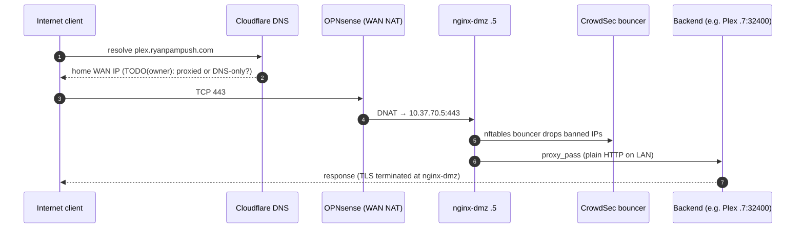
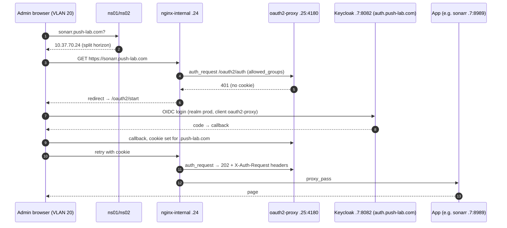
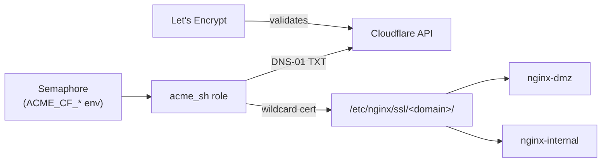

# 7. Ingress, authentication & TLS

Sources:
- live `nginx -T` on both proxies and the VPS
- `ansible/group_vars/{nginx_internal,nginxdmz,reverse_proxies}/`
- `ansible/roles/{enhanced_proxy_nginx,oauth2_proxy_nginx,acme_sh}`
- docker-stacks `oauth2proxy/`

## Entry points

| Path | Front door | Who uses it | Auth |
|---|---|---|---|
| Public web | Cloudflare DNS → OPNsense WAN NAT → **nginx-dmz 10.37.70.5** :443 | Internet | App-native (Plex, Keycloak, Nextcloud, …) |
| Public MQTT | → nginx-dmz :8883 (TLS stream) → Mosquitto .25:1883 | IoT/clients outside | Mosquitto auth |
| Internal web | split DNS → **nginx-internal 10.37.70.24** :443 | VLAN 20 admins, WireGuard | **Keycloak SSO via oauth2-proxy** (oauth2 mode) or app-native (traditional mode) |
| Internal git SSH | nginx-internal :2222 stream → gitea :2222 | devs, Komodo, runners | SSH keys |
| Off-site status | rangernet-vps nginx :443 → uptime-kuma | public | — |
| Remote admin | WireGuard (OPNsense, VLAN 90) / Tailscale | admin | keys |

## Public request flow

### nginx-dmz vhosts (live)

| Hostname | Upstream | In IaC? |
|---|---|---|
| auth.push-lab.com | Keycloak 10.37.70.7:8082 | no |
| invite.push-lab.com | wizarr .7:5690 | no |
| n8n.push-lab.com | .7:5678 | no |
| plex.push-lab.com, plex.ryanpampush.com | .7:32400 | no |
| request.push-lab.com, request.ryanpampush.com | seerr .7:5055 | no |
| speedtest.push-lab.com | .7:3006 | no |
| sso.push-lab.com | .7:4180 (**nothing listens**) | no |
| amp.push-lab.com | linuxgameserver .19:8080 | no |
| nc.patreons7.club, bigfile.patreons7.club | Nextcloud AIO .28:11000 | no |
| cargame-dev.push-lab.com | .25:3000 | **yes** |
| medianotifier.push-lab.com | .7:8088 | **yes** |
| wolfbawt.push-lab.com | .25:8000 | no |
| push-lab.com, ryanpampush.com, rangernet.dev (+www) | caddy .25:8180 | no |
| :8883 stream | mosquitto .25:1883 | yes (`reverse_proxies/mqtt.yml`) |

## Internal request flow with SSO

### nginx-internal vhosts (live)

The role default is `proxy_mode: oauth2`.

| Mode | Hostname → upstream |
|---|---|
| **oauth2** (Keycloak gate) | sonarr → .7:8989 · radarr → .7:7878 · lidarr → .7:8686 · code → .7:8443 · dozzle → .7:9999 (groups admin, devops) |
| **traditional** (app auth) | dashboard → .7:3002 · grafana → .25:3002 · semaphore → .25:3004 · komodo → .25:9120 · tracearr → .25:3005 · medianotifier → .7:8088 · prusabawt → .7:8083 · git → 10.37.80.4:3000 · sab → .7:8085 · readarr → .7:8787 · digx → .25:2283 · zigbee → 10.37.50.12:8080 · zwave → 10.37.50.12:8091 · truenas → .22:80 · synology → 10.37.20.4:5000 · zero → .25:3000 |
| apex landing | push-lab.com, ryanpampush.com, rangernet.dev → caddy .25:8180 |
| hand-made (not in IaC) | scrypted → 10.37.50.23:10443 (Scrypted NVR on IoT VLAN) |
| **retired 2026-11-15** | aap, esxi, vsphere via `enhanced_proxy_nginx_retired_domains`. Reach vCenter/ESXi directly at 10.37.10.35 / .17 / .18 from VLAN 20 or WireGuard; Management is unreachable from the DMZ proxy by design |
| streams | :2222 → gitea:2222 · :8883 → mosquitto .25:1883 |

> **Trap:** `enhanced_proxy_nginx` adds a `/health` → "OK" stub to every vhost, which hides an app's own `/health`. Never run it with `-e proxy_mode=traditional`: that deletes the shared oauth2 snippets and breaks other vhosts.

## Identity

- **Keycloak** 26.8 on docker (:8082, Postgres 18). Public hostname `auth.push-lab.com` (`KC_PROXY=edge`). Realm `prod`.
- **Clients:**
  - `oauth2-proxy` / `oauth2-proxy-multi-domain` (nginx-internal gate)
  - Grafana (generic OAuth; `groups` claim maps to Admin/Viewer)
  - media_notifier (OIDC)
- **oauth2-proxy** on docker-internal :4180: provider `keycloak-oidc`, cookie domain `.push-lab.com`. Secrets in the Komodo stack env.
- Not federated: Gitea, Semaphore, Komodo, TrueNAS and Synology use local accounts. TODO(owner): confirm.

## TLS

| Domain | Cert | Managed by |
|---|---|---|
| `*.rangernet.dev` | wildcard, ec-256 | Ansible `acme_sh` (`group_vars/*/acme.yml`) |
| `*.push-lab.com` | wildcard (RSA-4096 on nginx-internal) | acme.sh on the host, **hand-issued** |
| `*.ryanpampush.com`, `*.patreons7.club` | wildcard | hand-issued on nginx-dmz |
| uptime.push-lab.com (VPS) | TODO(owner) | VPS nginx |

Backends speak plain HTTP on the LAN. TLS terminates at the proxies, and Caddy runs with `auto_https off`.
