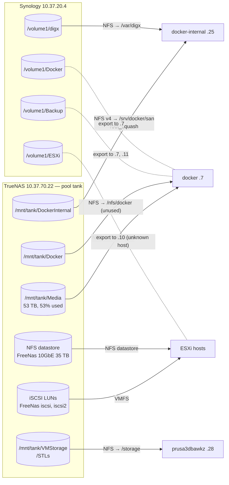

# 8. Storage & backup

Sources:
- `showmount -e` against both NAS boxes
- live `df` / `mount`
- vCenter datastores
- docker-stacks `docs/host-storage-migration.md`
- `terraform/envs/*/backend.hcl`

## Storage map

## NFS exports (live)

| Server | Export | Allowed clients | Mounted at |
|---|---|---|---|
| TrueNAS | `/mnt/tank/Media` | 10.37.70.7 | docker `/nfs/media` (Plex, *arr, Tdarr, fileshare) |
| TrueNAS | `/mnt/tank/DockerInternal` | 10.37.70.25 | docker-internal `/srv/docker/san` |
| TrueNAS | `/mnt/tank/Docker` | 10.37.70.0/24 | docker `/nfs/docker` (no stack uses it) |
| TrueNAS | `/mnt/tank/VMStorage` | 10.37.70.0/24, 10.37.20.0/24 | — |
| TrueNAS | `/mnt/tank/VMStorage/STLs` | 10.37.70.0/24 | prusa3dbawkz `/storage` |
| Synology | `/volume1/digx` | 10.37.70.25 | docker-internal `/var/digx` (Immich library) |
| Synology | `/volume1/Backup` | 10.37.70.7, 10.37.70.11 | TODO(owner): which job and host uses it? (.11 isn't a known host) |
| Synology | `/volume1/Docker` | 10.37.70.7 | not mounted |
| Synology | `/volume1/ESXi` | 10.37.70.10 | .10 isn't a known host; legacy? |

`/nfs/teslamate` on docker: TODO(owner) confirm the source export (it isn't in either showmount list).

## Container storage tiers (docker-internal)

| Tier | Path | Use for | Rule |
|---|---|---|---|
| **san** | `/srv/docker/san/<stack>` | Non-DB app data that should survive host loss (Grafana, InfluxDB, VictoriaLogs) | NFS root_squash. Container must run as **uid 1006** (`dockeruser`); copy files as dockeruser, never root |
| **local** | `/srv/docker/<stack>` (LV) | Databases, root-running containers, hot paths | Backed up by Veeam with the VM |
| **git** | in `docker-stacks` | Static config (Caddyfile, prometheus.yml, oauth2-proxy.cfg) | No secrets |
| named volumes | Docker | Postgres/Mongo for komodo, tracearr, cargame, wolfbawt, keycloak | local disk |

On the docker host, data is under `/opt/dockerconfigs/<stack>`, `/opt/dockerimages` and `/opt/plex-config` (local), plus `/downloads` (246 GB NVMe datastore) and `/transcode` (98 GB).

## VM storage

See [physical](02-physical.md#esxi-datastores).
- Terraform defaults to `ssd-local`.
- OPNsense, ns01, HAOS, Veeam and prusa sit partly on **TrueNAS iSCSI**, so they depend on TrueNAS being up.

## Backups

| What | How | Where | Notes |
|---|---|---|---|
| VMs | Veeam B&R (Veeam2022, 10.37.70.21) | TODO(owner): repository target and schedule | Veeam ports open on every host (`group_vars/all/main.yml`); agent on docker |
| Terraform state | S3 backend | Backblaze B2 bucket `pushlabterraformstate` (`prod/`, `lab/` keys) | **No state locking** |
| Terraform snapshots | CI uploads to Gitea release per apply | Gitea | — |
| Gitea | pre-upgrade dump (role `gitea`) | `/var/backups` on gitea | + Veeam |
| Technitium | manual snapshots | `/var/backups/technitium-*` on ns02 | Zone data also replicated ns01 → ns02 |
| cargame DB | sidecar pg_dump nightly 03:15, keep 14 d | named volume | — |
| Game saves | AMP backups | linuxgameserver `/backups` (393 GB) | — |
| Media | — | TrueNAS only | TODO(owner): snapshot/replication policy |
| docker-stacks config | Git | Gitea | Secrets in Komodo env/`.env` are not in Git |

TODO(owner): document restore tests and any off-site copy, other than B2 tfstate.
