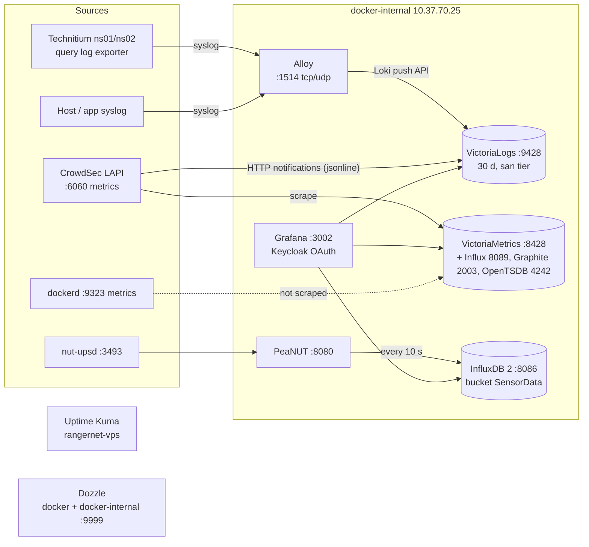
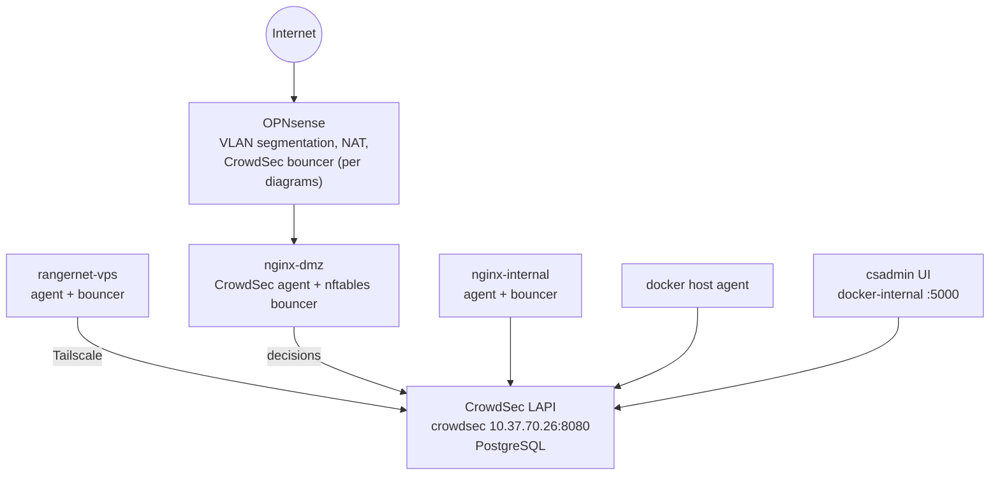

# 9. Observability & security

## Telemetry pipeline

| Component | Host:port | Notes |
|---|---|---|
| Alloy 1.21 | .25:1514 (syslog), :12345 (UI) | Forwards to VictoriaLogs through its Loki-compatible endpoint |
| VictoriaLogs 1.53 | .25:9428, logs.rangernet.dev | about 22 GB, 30-day retention, san tier |
| VictoriaMetrics 1.154 | .25:8428 | **Only scrape target is CrowdSec** (`prometheus.yml`). `--vmalert.proxyURL` points at a vmalert that doesn't exist |
| Grafana 13.2 | .25:3002, grafana.push-lab.com | Datasources: VictoriaMetrics, VictoriaLogs (plugin), InfluxDB |
| InfluxDB 2 | .25:8086 | UPS metrics from PeaNUT |
| TeslaMate Grafana | .7:3001 | Separate; reads TeslaMate Postgres |
| Uptime Kuma | VPS 127.0.0.1:3001 → uptime.push-lab.com | Off-site black-box monitoring. TODO(owner): list monitors |
| Dozzle | docker :9999 (SSO), docker-internal :9999 | Live container logs |
| Smokeping | .7:8281 | Latency |
| Komodo | komodo.push-lab.com | Container state per host; the Apprise alerter stack is defined but not deployed |
| CI alerts | `prod-drift-check` | Discord + PagerDuty on Terraform drift |

Gaps:
- No node-exporter or cAdvisor metrics. dockprom was decommissioned and nothing has replaced it.
- No alert rules (no vmalert, no Alertmanager).

## Security controls

| Layer | Control | Where defined |
|---|---|---|
| Perimeter | OPNsense VLAN rules, NAT | `group_vars/opnsense/vars.yml` (partial); the rest is in the UI |
| Edge IPS | CrowdSec agents + nftables bouncers on nginx-dmz, nginx-internal, docker and rangernet-vps; LAPI on `crowdsec` | role `crowdsec`, host_vars `crowdsec_enabled` |
| Host firewall | firewalld via `firewall_hardened` (allowlists, trusted VLANs, strict mode on VPS) | role defaults + host_vars |
| Identity | Keycloak realm `prod`, oauth2-proxy gate on internal admin apps | see [ingress](07-ingress-auth-tls.md) |
| Remote access | WireGuard (VLAN 90), Tailscale ACL tags | OPNsense / Tailscale admin |
| Secrets | Semaphore env, Komodo stack env, `.env` files on hosts, gitignored local files | **Not vaulted.** Some inline secrets are committed in docker-stacks (see findings) |
| Secret scanning | gitleaks pre-commit (this repo); `check-image-pins` (docker-stacks) | `.pre-commit-config.yaml` |
| Supply chain | Images pinned by digest; Renovate `minimumReleaseAge` 3 d; majors need approval | docker-stacks `renovate.json` |
| Patching | `update_all.yml` (Semaphore), ordered so the controller host goes last | `ansible/update_all.yml` |

See [findings](findings.md) for the gaps in these controls.
