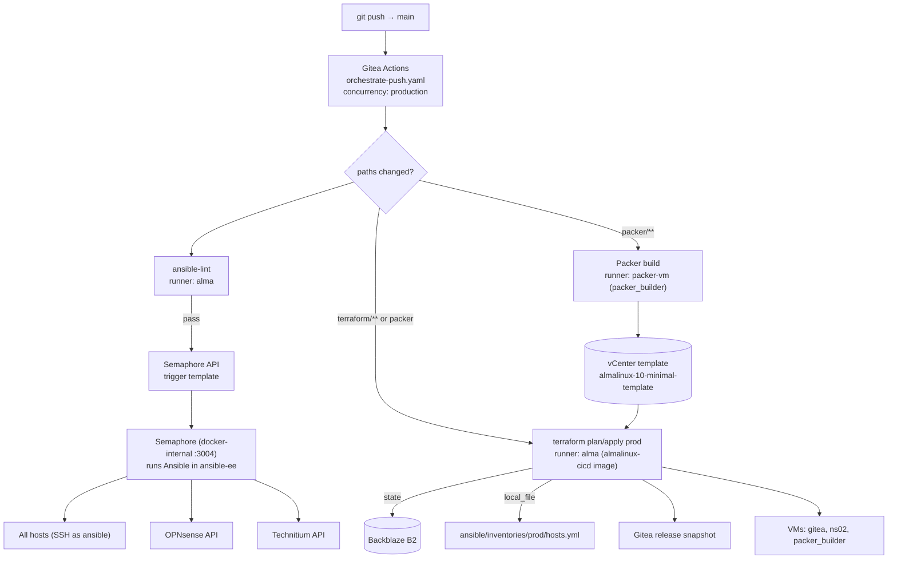
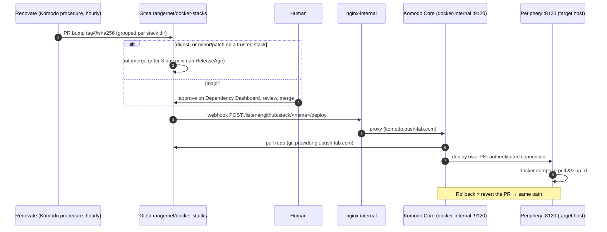
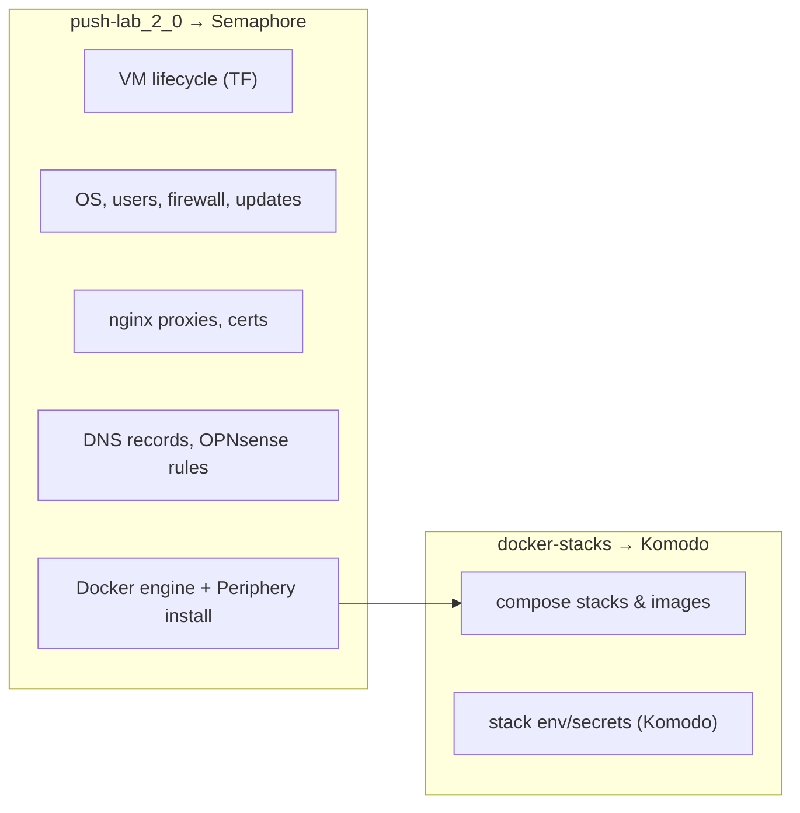

# 10. Automation & GitOps

There are two independent delivery pipelines. Both are hosted on Gitea (10.37.80.4, git.push-lab.com).

## Pipeline A: infrastructure (`push-lab_2_0`)

| Workflow | Trigger | Purpose |
|---|---|---|
| `orchestrate-push.yaml` | push to `main` | Main pipeline (above) |
| `orchestrate-dispatch.yaml` | manual | Same, with inputs (force Packer, firewall/onboard templates) |
| `prod-drift-check.yaml` | daily 03:00 | `terraform plan -detailed-exitcode` → Discord / PagerDuty |
| `rebuild-packer-images.yaml` | manual | Rebuild the template |
| `redeploy-vm.yaml` | manual | `terraform apply -target module.vm["…"]` |
| `ansible-lint` / `terraform-lint` | path-filtered push/PR | Lint |
| `build-ee.yaml` | `execution-environment/**` | Builds `git.push-lab.com/<owner>/ansible-ee` (AlmaLinux 10, ansible-core 2.18) |
| `build-ci-image.yaml` | push | Builds `almalinux-cicd` (Terraform 1.7.5, Packer 1.11.2); registry push disabled |

**Runners:**

| Label | Where | Executes |
|---|---|---|
| `alma` | gitea VM | Container runner (`gitea-runner`), jobs in `almalinux-cicd:latest` |
| `packer-vm` | packer_builder | Native, on the host |

**Semaphore:**
- Inventory is the whole `ansible/inventories/` directory: prod (Terraform-generated), manual, opnsense, lab.
- Templates include `site.yml`, `update_all.yml`, `technitium.yml` (project 1 / template 13), `opnsense.yml`, firewall, onboarding and proxy deploys.
- Secrets are in Semaphore environments.

**VM build chain:**
1. Packer `vsphere-iso` boots AlmaLinux 10.1 with a kickstart over HTTP :8080 (EFI, 2 vCPU / 4 GB / 40 GB, VLAN 80).
2. The VM is converted to a template.
3. Terraform `modules/vm` clones it and injects cloud-init: VMware datasource, netplan v2 static IPs, multi-NIC, IPv6 ULA, optional data disk, `prevent_destroy` variant.

## Pipeline B: containers (`docker-stacks`)

| Item | Detail |
|---|---|
| Komodo Core | v2.3.4 on docker-internal, Mongo 8.3. Core deploys itself (stack `komodo`); its own redeploy always logs "failed", so check health |
| Periphery | 2.3.4 on :8120. Hosts: docker, docker-internal, docker-secure, ns02, raspberrypi-ha, rangernet-vps (via Tailscale), plus gitea and packer_builder (they're in `docker_hosts`). Installed by `ansible/komodo-periphery.yml`; Core public key in `group_vars/all/main.yml` |
| Webhooks | One per stack. Gitea webhook IDs: docker 16–41, ns01 42, Pi 43–44 (`docker-stacks/HANDOFF.md`) |
| Renovate | `renovate/renovate:44`, config `docker-internal/renovate/config.js`. Tokens for Gitea, GitHub, GHCR and Docker Hub are in the Komodo env |
| Guards | pre-commit `check-image-pins.sh` rejects a digest pinned without a tag |
| Not covered | Nextcloud AIO (prusa), AMP (gameserver), HAOS: these manage their own updates |

## Ownership boundary

Rule of thumb:
- If it's inside a container, change it in **docker-stacks**.
- If it's the host, the network or the proxy in front of a container, change it in **push-lab_2_0**.
